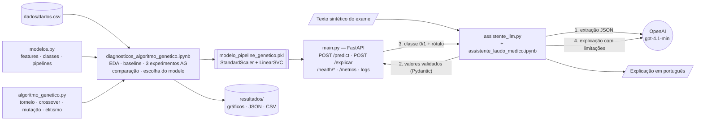

# Tech Challenge FIAP — Fase 2 (Projeto 1: Otimização de Modelos de Diagnóstico)

Otimização dos modelos de diagnóstico da Fase 1 com **algoritmos genéticos** e interpretação dos resultados com **LLM (OpenAI)**, servidos por uma **API FastAPI** com logging e métricas.

> Protótipo **educacional** de apoio à interpretação de resultados, treinado com dados públicos. **Não** é diagnóstico médico.

## Autores

- Denilson Dominguez — domingues.denilson2014@gmail.com
- Lucas Nascimento Lopes — lucaslsantos159@gmail.com
- Vinicius Breda Silva — vinicius_breda_silva@hotmail.com

## Links

- **Guia passo a passo (VS Code / Windows): [GUIA_EXECUCAO.md](GUIA_EXECUCAO.md)**
- Relatório técnico: [RELATORIO_TECNICO.md](RELATORIO_TECNICO.md)
- Vídeo de demonstração: https://www.youtube.com/watch?v=DQrM-L-gHNE
- Repositório: https://github.com/vbredasilva/FIAP-IA-TCC-02

## Visão geral

O dataset público **Breast Cancer Wisconsin** (569 exames, `dados/dados.csv`) é usado para classificar tumores em **Benigno (0)** ou **Maligno (1)** a partir de 4 características escolhidas na Fase 1 pela correlação com o diagnóstico: `concave_points_mean`, `concave_points_worst`, `perimeter_worst` e `radius_worst`.

### Requisitos da Fase 2 atendidos

- Algoritmo genético com codificação dos hiperparâmetros, seleção por torneio, crossover uniforme, mutação, elitismo e fitness por recall em validação cruzada.
- Comparação modelos originais × otimizados (accuracy, precision, recall, F1, matriz de confusão, ROC).
- 3 experimentos com configurações diferentes do AG (população, mutação, cruzamento, torneio, elitismo).
- Monitoramento e logging da API; documentação da arquitetura.
- Integração com LLM pré-treinada (OpenAI `gpt-4.1-mini`), prompt engineering e avaliação das interpretações.
- Projeto Python com `venv`, documentação e testes automatizados.

## Tecnologias

Python 3.11 · scikit-learn · pandas · NumPy · matplotlib/seaborn/plotly · FastAPI · Uvicorn · Pydantic · prometheus-client · OpenAI SDK · python-dotenv · pytest · VS Code + Jupyter.

## Estrutura de diretórios

```text
ProjetoTechChallenge2/
├── modelos.py                             # fonte única: features, classes, divisão treino/teste, pipelines, espaços de busca
├── algoritmo_genetico.py                  # algoritmo genético (operadores, execução, desempate, 3 experimentos)
├── main.py                                # API FastAPI (POST /predict, POST /explicar, health, métricas, logs)
├── assistente_llm.py                      # integração OpenAI: extração, validação, chamada da API, explicação, avaliação
├── diagnosticos_algoritmo_genetico.ipynb  # EDA + baseline + experimentos AG + comparação + exportação do modelo
├── assistente_laudo_medico.ipynb          # demonstração e avaliação da LLM
├── modelo_pipeline_genetico.pkl           # Pipeline(StandardScaler + LinearSVC) otimizado — usado pela API
├── dados/dados.csv                        # dataset público Breast Cancer Wisconsin
├── resultados/                            # gráficos, tabelas e JSON gerados pelos notebooks
├── tests/                                 # pytest (AG, modelo, API, LLM simulada, LLM real opcional)
├── requirements.txt · pytest.ini · .env.example · .gitignore
└── README.md · GUIA_EXECUCAO.md · RELATORIO_TECNICO.md
```

## Arquitetura



## Algoritmo genético

| Elemento | Implementação (`algoritmo_genetico.py`) |
|---|---|
| Indivíduo / genes | dicionário `{hiperparâmetro: valor}`; cada gene tem domínio discreto (`modelos.ESPACOS_BUSCA`) |
| População inicial | sorteio uniforme em cada domínio |
| Fitness | **recall** médio, `StratifiedKFold` 5 folds, só no treino; scaler ajustado dentro de cada fold (Pipeline) |
| Seleção | torneio de tamanho *k* |
| Cruzamento | uniforme (cada gene de um dos pais), com taxa de crossover |
| Mutação | ressorteio do gene no domínio, com taxa de mutação |
| Elitismo | os *n* melhores passam intactos |
| Cache | avaliações repetidas não são retreinadas |
| Reprodutibilidade | `random.Random(42)` próprio + folds com `random_state=42` (4 execuções completas geraram resultados idênticos) |
| Desempate | recall CV → F1 CV → menos avaliações → ordem (nunca usa o teste) |

Espaços de busca: KNN (`n_neighbors`, `weights`, `p` — 52 combinações), SVM linear (`C`, `class_weight`, `max_iter` — 36), Random Forest (`n_estimators`, `max_depth`, `min_samples_split`, `min_samples_leaf`, `max_features`, `class_weight` — 5.250).

### Experimentos

| Experimento | População | Gerações | Crossover | Mutação | Torneio | Elites |
|---|---|---|---|---|---|---|
| Conservador | 8 | 10 | 0,70 | 0,05 | 2 | 1 |
| Equilibrado | 12 | 10 | 0,80 | 0,15 | 3 | 2 |
| Exploratório | 20 | 10 | 0,90 | 0,30 | 4 | 2 |

Cada experimento é executado nos 3 classificadores (9 execuções).

### Resultados principais (conjunto de teste, 171 amostras)

| Modelo | Recall original → AG | Falsos negativos | Accuracy original → AG | F1 original → AG |
|---|---|---|---|---|
| KNN | 0,8438 → 0,8594 | 10 → 9 | 0,9298 → 0,9240 | 0,9000 → 0,8943 |
| SVM | 0,9375 → **0,9531** | 4 → **3** | 0,9649 → 0,9591 | 0,9524 → 0,9457 |
| Random Forest | 0,8906 → 0,9219 | 7 → 5 | 0,9357 → 0,9474 | 0,9120 → 0,9291 |

O AG aumentou o recall (métrica priorizada) nos três modelos. Em KNN e SVM houve queda de accuracy/precision/F1 — a troca esperada ao priorizar recall. **Modelo da API: SVM otimizado** (`C=1`, `class_weight="balanced"`), escolhido pelo maior recall na validação cruzada. Detalhes: [RELATORIO_TECNICO.md](RELATORIO_TECNICO.md).

## LLM

1. Texto sintético → `gpt-4.1-mini` extrai os 4 valores em JSON (`temperature=0`, `null` se ausente).
2. **Pydantic** valida: ausente → `revisao_necessaria`; negativo → `entrada_invalida` (a API não é chamada).
3. Valores válidos → `POST /predict` → classe do modelo otimizado.
4. LLM gera explicação com seções fixas (dados, resultado, interpretação, limitações, próximos passos), sem inventar diagnóstico, probabilidade ou tratamento.
5. Avaliação: 5 cenários sintéticos + checklist automático.

O fluxo está disponível de duas formas: no notebook `assistente_laudo_medico.ipynb` e pela própria API, no endpoint **`POST /explicar`**, que recebe o texto do exame e devolve a classificação do modelo junto com a explicação.

## API

| Método | Rota | Descrição |
|---|---|---|
| GET | `/` | informações e endpoints |
| GET | `/health/live` | processo no ar |
| GET | `/health/ready` | modelo carregado (arquivo, etapas, classes) |
| GET | `/metrics` | métricas Prometheus |
| POST | `/predict` | classificação a partir dos 4 valores |
| POST | `/explicar` | texto do exame → LLM extrai os valores → modelo classifica → LLM explica (requer `OPENAI_API_KEY`) |

Requisição:

```json
{"concave_points_mean": 0.1471, "concave_points_worst": 0.2654, "perimeter_worst": 184.6, "radius_worst": 25.38}
```

Resposta 200:

```json
{"output": "1", "label": "Maligno", "model_file": "modelo_pipeline_genetico.pkl", "processing_time_ms": 1.5, "request_id": "..."}
```

`POST /explicar` — requisição:

```json
{"texto_exame": "Exame sintético: pontos côncavos (média) 0,121; pontos côncavos (pior valor) 0,245; perímetro (pior valor) 165,3; raio (pior valor) 24,8."}
```

Resposta 200: `status` (`sucesso`, `revisao_necessaria` ou `entrada_invalida`), `parametros` extraídos, `predicao` (mesmo formato do `/predict`) e `explicacao` em português. Sem chave da OpenAI o endpoint responde **503**; falha na OpenAI responde **502**. O `/predict` funciona sem a chave.

Erros: **422** (campo ausente, extra, negativo, não numérico, infinito — com campo e mensagem), **405** (método errado), **503** (modelo indisponível), **500** (erro interno, registrado em log). Headers `X-Request-ID` e `X-Process-Time` em todas as respostas. `MODEL_PATH` (opcional) troca o arquivo do modelo; **não há fallback**: se o arquivo não for um Pipeline com scaler, a API não sobe.

## Como executar

Passo a passo completo, com solução de problemas: **[GUIA_EXECUCAO.md](GUIA_EXECUCAO.md)**.

## Testes

```powershell
python -m pytest                                   # 78 testes aprovados, 6 pulados (OpenAI real)
$env:RUN_OPENAI_TESTS = "1"; python -m pytest tests/test_openai_real.py -v   # 5 cenários + POST /explicar com OpenAI real
```

Resultados registrados (Python 3.11.9, Windows 11): **78 passed, 6 skipped**; com OpenAI real, os 5 cenários e o teste do `POST /explicar` passaram.
