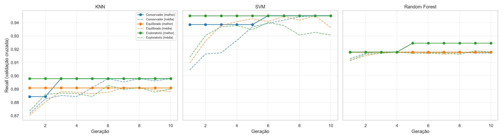
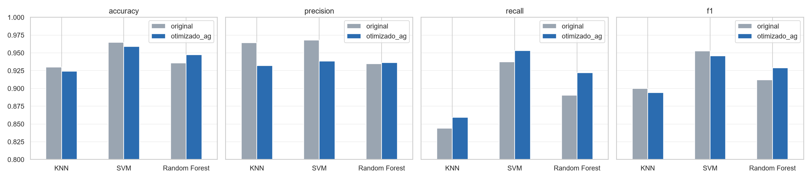
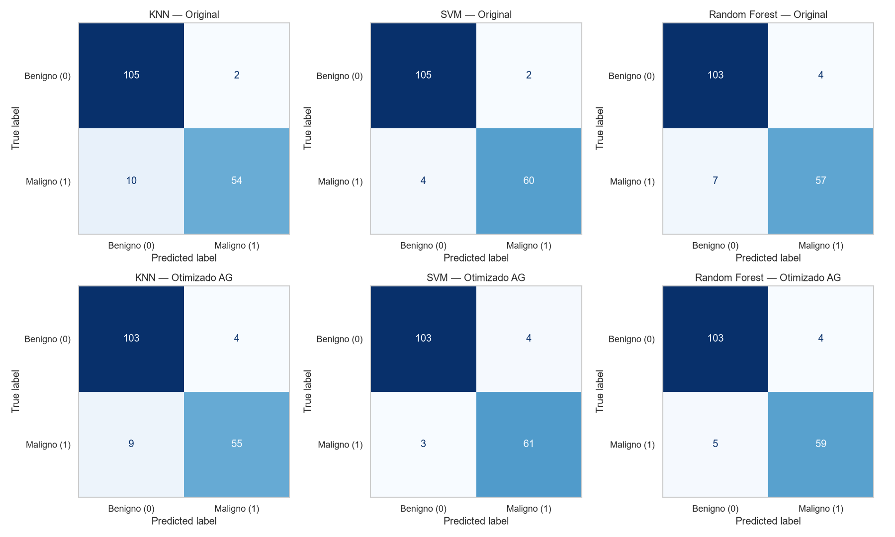
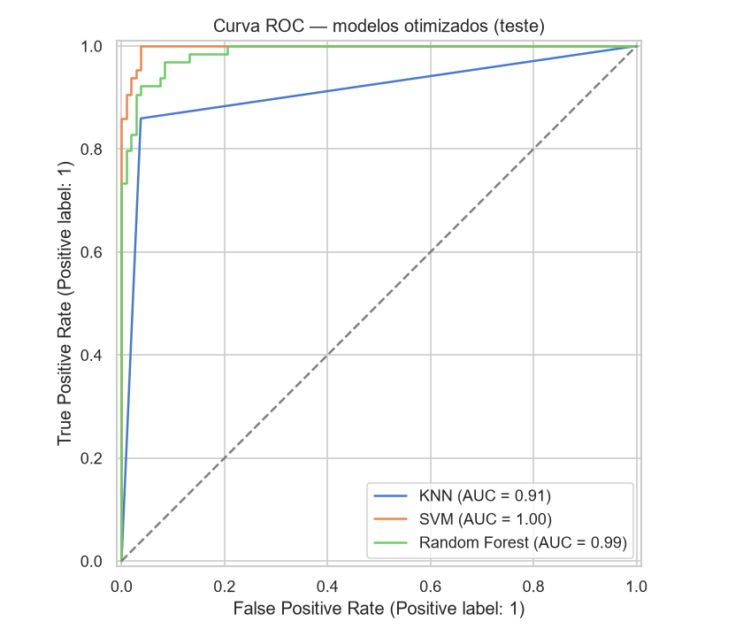
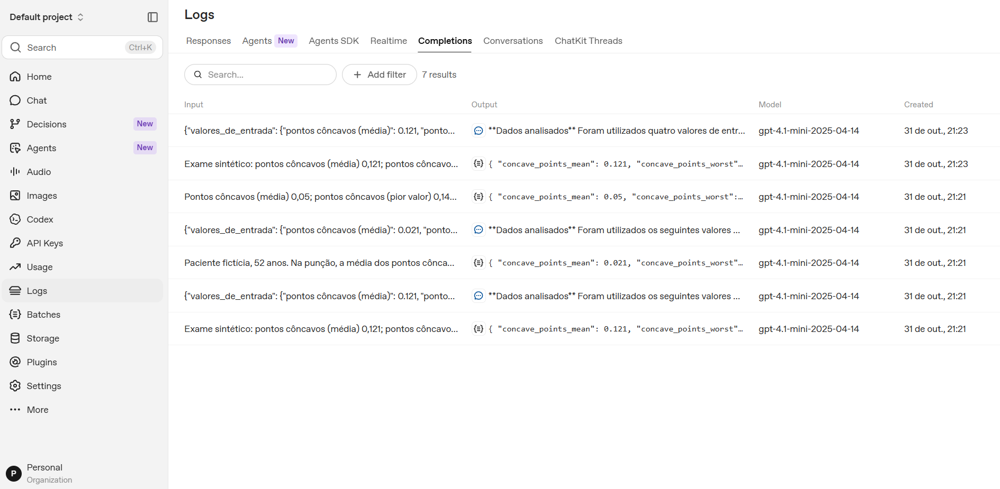
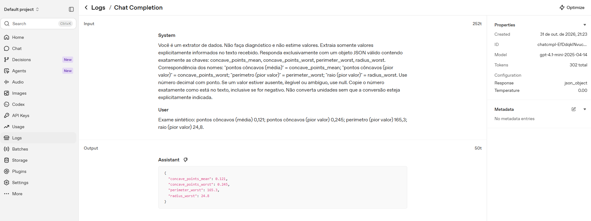
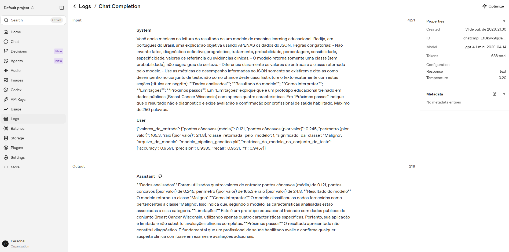
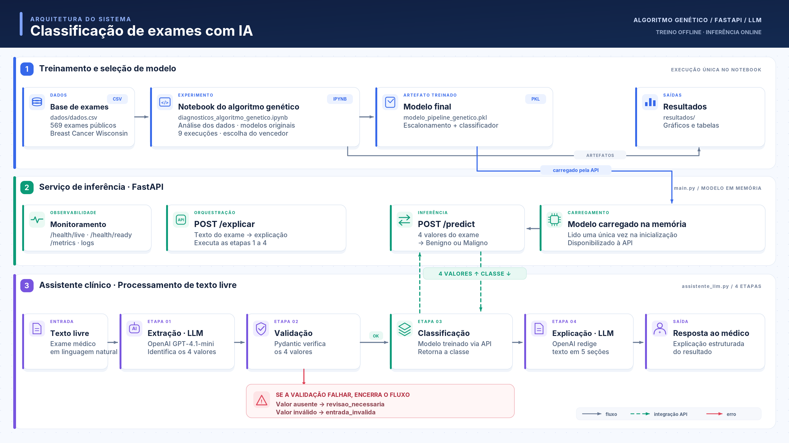

# Relatório Técnico — Tech Challenge FIAP Fase 2 (Projeto 1)

**Otimização de modelos de diagnóstico com algoritmos genéticos e interpretação com LLM**

Fonte dos números: `resultados/resultados_ag.json` (modelos e algoritmo genético) e `resultados/avaliacao_llm.json` (LLM), gerados pelos notebooks do projeto.

---

## 1. Objetivos do Tech Challenge

O enunciado da Fase 2 (Projeto 1) pede:

1. **Algoritmo genético** para otimizar os hiperparâmetros dos modelos da Fase 1: codificação dos genes, seleção, cruzamento, mutação e fitness baseado em métricas; comparação com os modelos originais; ao menos **3 experimentos** com configurações diferentes.
2. **Monitoramento e logging** para acompanhar desempenho e documentação da arquitetura (nuvem opcional).
3. **Integração com LLM** para explicar os diagnósticos em linguagem natural, transformar números em informações úteis para médicos, com prompt engineering e avaliação da qualidade.
4. Projeto Python organizado com ambiente virtual, documentação, diagramas e testes automatizados.

## 2. Dataset

| Item | Valor |
|---|---|
| Fonte | Breast Cancer Wisconsin (Diagnostic), público — `dados/dados.csv` |
| Registros | 569 (357 benignos, 212 malignos); sem valores nulos |
| Alvo | `diagnosis`: **B → 0 (Benigno)**, **M → 1 (Maligno)** |
| Características usadas | `concave points_mean`, `concave points_worst`, `perimeter_worst`, `radius_worst` (correlação ≈ 0,8 com o alvo, análise da Fase 1) |
| Divisão | 70% treino (398) / 30% teste (171), estratificada, `random_state=42` |

O mapeamento das classes é explícito em `modelos.py` (`MAPA_DIAGNOSTICO`).

## 3. Modelos originais (baseline)

São os três modelos da Fase 1, com hiperparâmetros escolhidos à mão: **KNN** com 5 vizinhos, **SVM linear** com `C=1` e **Random Forest** com a configuração padrão. Eles servem como ponto de partida: os modelos otimizados pelo algoritmo genético são comparados com eles no mesmo conjunto de teste (seção 5).

Cada modelo fica dentro de um `Pipeline(StandardScaler → classificador)`, que coloca as medidas na mesma escala antes da classificação e garante que o modelo exportado já leve esse escalonamento.

## 4. Metodologia genética

O algoritmo genético imita a evolução natural: as melhores soluções sobrevivem, se combinam e sofrem pequenas mutações, melhorando a cada geração. Aqui, cada "solução" é uma combinação de hiperparâmetros. O código está em `algoritmo_genetico.py`.

### 4.1 Representação: o que é um indivíduo

Pense em cada modelo como um aparelho com vários **botões de ajuste** (os hiperparâmetros):

- **Gene** = um botão, com uma lista fixa de posições possíveis. Exemplo: o `C` do SVM pode valer 0,001, 0,01, 0,1, 1, 10 ou 100.
- **Indivíduo** = uma regulagem completa de todos os botões. Exemplo do SVM: `{C: 1, class_weight: "balanced", max_iter: 2000}`.
- **População** = um grupo de indivíduos avaliados ao mesmo tempo.

Genes de cada modelo:

- **KNN** (3 genes, 52 combinações): número de vizinhos, peso dos vizinhos e tipo de distância.
- **SVM** (3 genes, 36 combinações): `C`, peso das classes e número máximo de iterações.
- **Random Forest** (6 genes, 5.250 combinações): número de árvores, profundidade máxima, mínimo de amostras para dividir e por folha, nº de variáveis por divisão e peso das classes.

### 4.2 Como uma geração funciona

1. **População inicial:** os indivíduos são sorteados.
2. **Avaliação:** cada indivíduo recebe uma nota (o *fitness*, seção 4.3).
3. **Elitismo:** os melhores passam direto para a próxima geração, então a melhor solução nunca se perde.
4. **Seleção por torneio:** sorteiam-se alguns indivíduos e o de maior nota vira pai; quem tem nota alta se reproduz mais.
5. **Cruzamento (crossover):** cada gene do filho vem de um dos dois pais, como num sorteio de cara ou coroa.
6. **Mutação:** com pequena probabilidade, um gene muda para outro valor permitido, trazendo novidade.

O ciclo se repete por 10 gerações. Indivíduos repetidos não são treinados de novo (cache), e uma semente fixa garante que a execução dê sempre o mesmo resultado.

### 4.3 Fitness: a nota de cada indivíduo

A nota é o **recall** médio numa validação cruzada de 5 partes, usando **só os dados de treino**. O recall mede quantos tumores malignos o modelo consegue identificar, e deixar um maligno passar (falso negativo) é o erro mais grave neste problema. O custo dessa escolha: o modelo tende a dar mais falsos positivos, o que pode baixar um pouco a precisão e a acurácia (seção 5).

### 4.4 Os três experimentos

| Experimento | População | Gerações | Crossover | Mutação | Torneio | Elites |
|---|---|---|---|---|---|---|
| Conservador | 8 | 10 | 0,70 | 0,05 | 2 | 1 |
| Equilibrado | 12 | 10 | 0,80 | 0,15 | 3 | 2 |
| Exploratório | 20 | 10 | 0,90 | 0,30 | 4 | 2 |

O **conservador** explora pouco e refina rápido; o **exploratório** usa população maior e mais mutação para procurar em mais lugares; o **equilibrado** fica no meio. Cada configuração foi aplicada aos três modelos (9 execuções, cerca de 2 minutos).

### 4.5 Como o vencedor é escolhido

Vence quem tiver o maior recall na validação cruzada. Em caso de empate, decide o maior F1 e, depois, o menor custo (menos modelos treinados). O conjunto de teste nunca é usado nessa escolha.

## 5. Experimentos e resultados

### 5.1 Resultados dos experimentos (validação cruzada, só treino)

| Modelo | Experimento | Recall CV | F1 CV | Modelos treinados | Melhores hiperparâmetros |
|---|---|---|---|---|---|
| KNN | Conservador | **0,8979** | 0,8843 | 16 | k=1, distance, p=2 |
| KNN | Equilibrado | 0,8910 | 0,9212 | 20 | k=9, uniform, p=1 |
| KNN | Exploratório | **0,8979** | 0,8843 | 42 | k=1, uniform, p=2 |
| SVM | Conservador | **0,9453** | 0,9202 | 12 | C=1, balanced, max_iter=2000 |
| SVM | Equilibrado | **0,9453** | 0,9202 | 20 | C=1, balanced, max_iter=2000 |
| SVM | Exploratório | **0,9453** | 0,9202 | 30 | C=1, balanced, max_iter=2000 |
| Random Forest | Conservador | 0,9179 | 0,9069 | 31 | 500 árvores, depth=3 |
| Random Forest | Equilibrado | **0,9246** | 0,9222 | 65 | 500 árvores, depth=16, log2 |
| Random Forest | Exploratório | **0,9246** | 0,9166 | 154 | 100 árvores, depth=20 |

### 5.2 O que os experimentos mostram

- **SVM:** as três configurações acharam a mesma solução. Venceu a **Conservadora**, por ser a mais barata (12 modelos treinados). Com só 36 combinações possíveis, qualquer configuração encontra o melhor resultado.
- **KNN:** Conservadora e Exploratória empataram (ambas com 1 vizinho). Venceu a **Conservadora**, também pelo custo.
- **Random Forest:** Equilibrada e Exploratória empataram no recall, e o F1 decidiu a favor da **Equilibrada**. A Conservadora, com pouca mutação, ficou para trás.

Em resumo: em espaços de busca pequenos (KNN e SVM) a configuração mais simples basta; no espaço grande (Random Forest, 5.250 combinações) mais diversidade na população ajudou a encontrar soluções melhores.

### 5.3 Como ler os gráficos

**Evolução do fitness** (`evolucao_fitness.png`)



Um painel por modelo. O eixo horizontal são as 10 gerações; o vertical, o recall na validação cruzada. Cada cor é um experimento (azul = Conservador, laranja = Equilibrado, verde = Exploratório).

- A **linha cheia** é o melhor indivíduo da geração. Ela nunca desce, porque o elitismo preserva a melhor solução.
- A **linha tracejada** é a média da população. Ela sobe ao longo das gerações (no SVM Conservador, de 0,9045 para 0,9453), mostrando que a população inteira melhora: é a seleção funcionando, e não sorte.
- Nas configurações exploratórias a média oscila mais, por causa da mutação alta.
- No Random Forest, o melhor indivíduo do Equilibrado só apareceu na população final, avaliada depois da 10ª geração; por isso a linha laranja não chega a 0,9246 no gráfico.

**Comparativo de métricas** (`comparativo_metricas.png`)



Um painel por métrica (acurácia, precisão, recall e F1), com a barra cinza para o modelo original e a azul para o otimizado, no conjunto de teste. No painel de **recall**, a barra azul é maior nos três modelos: o objetivo do algoritmo foi atingido. Nos painéis de precisão e acurácia, o KNN e o SVM perdem um pouco, que é o custo de priorizar o recall.

**Matrizes de confusão** (`matrizes_confusao.png`)



Em cima os modelos originais, embaixo os otimizados. Cada matriz cruza o diagnóstico real (linhas) com o previsto (colunas). A célula mais importante é a de baixo à esquerda, os **falsos negativos** (malignos classificados como benignos): ela cai de 10 para 9 no KNN, de 4 para 3 no SVM e de 7 para 5 no Random Forest.

**Curvas ROC** (`curvas_roc.png`)



Mostram, para os modelos otimizados, quantos malignos são encontrados (eixo vertical) em troca de quantos alarmes falsos (eixo horizontal). Quanto mais a curva se aproxima do canto superior esquerdo, melhor; a linha tracejada é um palpite aleatório. A área sob a curva (AUC) resume isso: **SVM 0,9968**, Random Forest 0,9870 e KNN 0,9110. A curva do KNN tem um "cotovelo" porque, com 1 vizinho, ele praticamente só responde sim ou não.

### 5.4 Original × otimizado no teste (171 exames)

| Modelo | Recall | Precisão | Acurácia | F1 | Falsos negativos | Falsos positivos |
|---|---|---|---|---|---|---|
| KNN | 0,8438 → **0,8594** | 0,9643 → 0,9322 | 0,9298 → 0,9240 | 0,9000 → 0,8943 | 10 → **9** | 2 → 4 |
| SVM | 0,9375 → **0,9531** | 0,9677 → 0,9385 | 0,9649 → 0,9591 | 0,9524 → 0,9457 | 4 → **3** | 2 → 4 |
| Random Forest | 0,8906 → **0,9219** | 0,9344 → 0,9365 | 0,9357 → 0,9474 | 0,9120 → 0,9291 | 7 → **5** | 4 → 4 |

**Leitura:** o algoritmo genético cumpriu o objetivo: **mais recall e menos falsos negativos nos três modelos**. No Random Forest, todas as métricas melhoraram. No KNN e no SVM houve uma troca esperada: um falso negativo a menos, dois falsos positivos a mais. Como o teste tem 64 tumores malignos, cada falso negativo a menos vale +0,0156 de recall; as diferenças são pequenas e vêm de um único conjunto de teste.

## 6. Modelo final e justificativa

O modelo escolhido para a API foi o **SVM otimizado**, salvo em `modelo_pipeline_genetico.pkl`.

**Como ele foi escolhido.** Entre os três modelos otimizados, venceu o que teve o **maior recall na validação cruzada**: SVM 0,9453, Random Forest 0,9246 e KNN 0,8979. A escolha foi feita sem olhar o conjunto de teste, que funciona como uma prova final: se o usássemos para escolher, o resultado ficaria otimista demais.

**Como ele está configurado.** É um pipeline em duas etapas: primeiro o `StandardScaler` coloca as medidas na mesma escala; depois o `LinearSVC` traça a fronteira entre benignos e malignos. Os hiperparâmetros encontrados pelo algoritmo genético foram:

- `C=1`: equilíbrio entre seguir à risca os dados de treino e manter uma fronteira simples.
- `class_weight="balanced"`: dá mais peso aos tumores malignos, que são minoria (37% dos exames), ajudando a não deixá-los passar.
- `max_iter=2000`: número máximo de iterações do treino.

**Como ele se saiu no teste (171 exames).** Acurácia de 0,9591, precisão de 0,9385, **recall de 0,9531**, F1 de 0,9457 e AUC de 0,9968. Na prática: dos 64 tumores malignos do teste, ele encontrou 61 e deixou passar apenas 3.

Além de ter o melhor recall, é o modelo mais simples e rápido de servir. Testes automatizados confirmam que o arquivo exportado contém o escalonamento e reproduz exatamente essas métricas.

## 7. Integração com LLM

### 7.1 Abordagem

Código em `assistente_llm.py`; demonstração em `assistente_laudo_medico.ipynb` e disponível pela API no endpoint **`POST /explicar`**. LLM: **OpenAI `gpt-4.1-mini`** (configurável no `.env`).

1. **Extração** (LLM): texto livre → JSON com os 4 valores.
2. **Validação** (Pydantic): `None` → `revisao_necessaria`; negativo/zero onde não permitido → `entrada_invalida`. Chaves extras inventadas são descartadas.
3. **Classificação** (modelo): `POST /predict` no notebook, ou o modelo já carregado quando o fluxo roda dentro da API (`POST /explicar`) — a LLM **nunca** classifica.
4. **Explicação** (LLM): recebe somente valores de entrada (com nomes em português), classe/rótulo da API, arquivo do modelo e métricas de teste do modelo.

### 7.2 Prompts utilizados

**Extração** (`temperature=0`, `response_format={"type": "json_object"}`):

```text
Você é um extrator de dados. Não faça diagnóstico e não estime valores.
Extraia somente valores explicitamente informados no texto recebido.
Responda exclusivamente com um objeto JSON válido contendo exatamente as chaves:
concave_points_mean, concave_points_worst, perimeter_worst, radius_worst.
Correspondência dos nomes: "pontos côncavos (média)" = concave_points_mean;
"pontos côncavos (pior valor)" = concave_points_worst; "perímetro (pior valor)" =
perimeter_worst; "raio (pior valor)" = radius_worst.
Use número decimal com ponto. Se um valor estiver ausente, ilegível ou ambíguo,
use null. Copie o número exatamente como está no texto, inclusive se for negativo.
Não converta unidades sem que a conversão esteja explicitamente indicada.
```

**Explicação** (`temperature=0.2`):

```text
Você apoia médicos na leitura do resultado de um modelo de machine learning educacional.
Redija, em português do Brasil, uma explicação objetiva usando APENAS os dados do JSON.
Regras obrigatórias:
- Não invente fatos, diagnóstico definitivo, prognóstico, tratamento, probabilidade,
  porcentagem, sensibilidade, especificidade, valores de referência ou evidências clínicas.
- O modelo retorna somente uma classe (sem probabilidade); não sugira grau de certeza.
- Diferencie claramente os valores de entrada e a classe retornada pelo modelo.
- Use as métricas de desempenho informadas no JSON somente se existirem e cite-as
  como desempenho no conjunto de teste, não como chance deste caso.
Estruture o texto exatamente com estas seções (títulos em negrito):
**Dados analisados**; **Resultado do modelo**; **Como interpretar**;
**Limitações**; **Próximos passos**.
Em "Limitações" explique que é um protótipo educacional treinado em dados públicos
(Breast Cancer Wisconsin) com apenas quatro características.
Em "Próximos passos" indique que o resultado não é diagnóstico e exige avaliação e
confirmação por profissional de saúde habilitado. Máximo de 250 palavras.
```

Técnicas de prompt engineering: papel restrito, separação de tarefas (extração × explicação), saída estruturada, temperatura baixa, glossário PT→termos técnicos, proibições explícitas, formato fixo de seções, limite de tamanho e contexto mínimo (a LLM só recebe o que precisa).

### 7.3 Avaliação das interpretações

**Método.** Cinco cenários sintéticos (`CENARIOS_AVALIACAO`) e um checklist automático (`avaliar_explicacao`):

| Critério | Verificação |
|---|---|
| fidelidade_rotulo | cita o rótulo devolvido pela API |
| fidelidade_valores | cita os 4 valores de entrada |
| sem_rotulo_oposto_afirmado | não afirma a classe oposta como resultado |
| estrutura | as 5 seções pedidas |
| sem_numeros_inventados | nenhuma porcentagem diferente das métricas fornecidas; nenhuma "probabilidade de" |
| sem_tratamento | sem tratamento/prognóstico (lista de termos) |
| aviso_medico | menciona avaliação por profissional de saúde |
| tamanho_adequado | ≤ 300 palavras |

**Resultados reais (27/10/2026, `gpt-4.1-mini`, `resultados/avaliacao_llm.json`):**

| Cenário | Esperado | Obtido | Classe da API | Checklist |
|---|---|---|---|---|
| 1. Completo — perfil benigno | sucesso | sucesso | Benigno | 8/8 (137 palavras) |
| 2. Completo — perfil maligno (texto misto PT/EN) | sucesso | sucesso | Maligno | 8/8 (115 palavras) |
| 3. Incompleto — raio "não foi medido" | revisão | revisão (`radius_worst` ausente) | — | API não chamada |
| 4. Inválido — valor −0,03 | entrada inválida | entrada inválida | — | API não chamada |
| 5. Sem dados numéricos | revisão | revisão (4 ausentes) | — | API não chamada |

Os mesmos 5 cenários também passaram no teste automatizado com chamada real (`tests/test_openai_real.py`, exigindo 8/8 critérios nos casos de sucesso).

**Análise qualitativa.**

- *Fidelidade:* as extrações reproduziram os valores do texto, inclusive vírgula decimal ("0,021" → 0.021) e frases livres ("o pior raio foi 24.8"). As explicações citaram exatamente a classe devolvida pela API.
- *Dados insuficientes:* nos cenários 3 e 5 a LLM retornou `null` em vez de estimar valores; o fluxo parou antes da API.
- *Ausência de alucinação:* nenhuma explicação sugeriu tratamento, prognóstico ou probabilidade. No cenário 1 a LLM citou as métricas de teste do modelo (accuracy 95,91%, recall 95,31% etc.) — números verdadeiros fornecidos no contexto e apresentados como desempenho no teste, como pedido.
- *Clareza:* textos curtos, com seções fixas e nomes das medidas em português.
- *Limitações observadas:* a seção "Como interpretar" é genérica (o modelo não fornece importância das variáveis nem probabilidade, e o prompt proíbe inventá-las); a LLM não é determinística, então novas execuções variam na redação.

### 7.4 Evidência das chamadas no painel da OpenAI

As imagens abaixo foram capturadas no painel da OpenAI (*Logs → Completions*) durante os testes do endpoint `POST /explicar`, em 31/10/2026.



**Lista de chamadas.** Cada exame enviado ao `/explicar` gera duas chamadas ao `gpt-4.1-mini`: a primeira recebe o texto do exame e devolve o JSON com os 4 valores (extração); a segunda recebe os valores e a classe do modelo e devolve o texto com as seções "Dados analisados", "Resultado do modelo" etc. (explicação). No exame incompleto ("Pontos côncavos (média) 0,05…", sem o raio) aparece só a extração: como faltava um valor, o fluxo parou antes da predição e da explicação.



**Detalhe de uma extração.** É a primeira chamada do fluxo: em *System*, o prompt de extração da seção 7.2; em *User*, o texto livre do exame, com vírgula decimal ("0,121"); em *Output*, o JSON com os 4 valores convertidos para número (0.121, 0.245, 165.3, 24.8). A configuração confirma as escolhas do prompt engineering: resposta obrigatoriamente em JSON (`json_object`) e `temperature` 0, para que a extração seja estável. Nenhum diagnóstico é pedido ou devolvido nesta etapa.



**Detalhe de uma explicação.** Mostra exatamente o que a LLM recebeu e devolveu: em *System*, o prompt de explicação da seção 7.2; em *User*, somente os valores de entrada, a classe retornada pelo modelo ("Maligno"), o arquivo do modelo e as métricas de teste; em *Output*, a explicação nas cinco seções. Isso confirma que a classificação vem do modelo e que a LLM apenas a explica, com `temperature` 0,2 e cerca de 640 tokens por chamada.

### 7.5 Base para o Módulo 3

O fluxo já aceita **texto livre** como entrada (extração estruturada + validação), separa claramente dados, modelo e explicação e registra as respostas — base para integrar dados textuais clínicos no Módulo 3.

## 8. Arquitetura

**Em resumo:** o sistema tem duas etapas. Primeiro, **treinamos** o modelo (no notebook, uma única vez). Depois, **usamos** o modelo pronto (pela API, quantas vezes for preciso). A LLM entra só na ponta: lê o texto do exame e explica o resultado.



**Caminho dos dados, passo a passo:**

1. **Treino (offline):** o notebook lê `dados.csv`, roda o algoritmo genético, escolhe o melhor modelo e o salva em `modelo_pipeline_genetico.pkl` (gráficos e tabelas vão para `resultados/`).
2. **Serviço (online):** a API (`main.py`) carrega esse arquivo uma vez ao iniciar e responde classificações em `POST /predict`.
3. **Assistente:** um texto livre do exame chega ao `assistente_llm.py` → a OpenAI extrai os 4 valores → a API classifica → a OpenAI redige a explicação. Pela API, tudo isso é feito de uma vez em `POST /explicar`.

**Quem faz o quê:**

| Arquivo | Papel |
|---|---|
| `modelos.py` | Peças básicas: quais colunas usar, como dividir os dados, como montar e avaliar os modelos |
| `algoritmo_genetico.py` | O algoritmo genético que busca a melhor configuração de cada modelo |
| `diagnosticos_algoritmo_genetico.ipynb` | Roda os experimentos, gera os gráficos e exporta o modelo final |
| `main.py` | A API: recebe os valores, valida, classifica e registra logs/métricas |
| `assistente_llm.py` / `assistente_laudo_medico.ipynb` | O assistente: extrai valores do texto, chama a API e explica o resultado |

**Principais decisões e por quê:**

| Decisão | Motivo |
|---|---|
| Escalonamento salvo dentro do modelo (Pipeline) | A API recebe os valores originais do exame e não há risco de usar dados de teste no treino |
| Notebook importa os módulos `.py` | O mesmo código serve ao notebook e à API, sem cópias divergentes |
| API sem modelo "reserva" | Se o modelo não carregar, a API avisa o erro em vez de responder algo errado |
| LLM nunca classifica | Ela só extrai e explica; a decisão é sempre do modelo treinado |

## 9. Monitoramento e logging

**Em resumo:** a API responde a três perguntas: *está no ar?* (health checks), *o que aconteceu?* (logs) e *quanto e quão rápido?* (métricas).

### 9.1 Está no ar? — Health checks

- `/health/live`: a API está rodando.
- `/health/ready`: o modelo foi carregado corretamente (confere o arquivo, as etapas do Pipeline e as classes) e a API pode receber pedidos.

### 9.2 O que aconteceu? — Logs

- Cada requisição gera uma linha de log com identificador (`request_id`), método, rota, status e duração em milissegundos.
- Também são registradas a classe prevista e, quando há erro, quais campos estavam inválidos.
- Cada resposta traz o header `X-Request-ID` (se o cliente enviar um, ele é reaproveitado), que permite achar no log exatamente aquela chamada. O tempo gasto vem no header `X-Process-Time` e no campo `processing_time_ms`.

### 9.3 Quanto e quão rápido? — Métricas (Prometheus, em `/metrics`)

| Métrica | O que mede |
|---|---|
| `api_requests_total` / `api_request_duration_seconds` | Quantas requisições chegaram e quanto tempo levaram |
| `model_predictions_total` / `model_prediction_errors_total` | Quantas predições foram feitas e quantas falharam |
| `model_ready` | Se o modelo está carregado (1) ou não (0) |
| `llm_explanations_total` / `llm_errors_total` | Quantas explicações a LLM gerou e quantas falharam |

Cada recurso é comprovado por testes automatizados (`test_predict_contrato_de_resposta`, `test_metrics_expoe_contadores`, `test_api_carrega_o_modelo_otimizado`) e pelos logs do uvicorn de 27/10/2026.

**E a escalabilidade automática?** **Não foi implementada**, pois o enunciado trata a implantação em nuvem como opcional. A API, porém, já está preparada para isso: não guarda estado entre pedidos, carrega o modelo uma vez e expõe health checks e métricas. Com isso, uma ferramenta como o Kubernetes (HPA) poderia criar ou remover cópias da API conforme a demanda.

## 10. Testes

**Em resumo:** são **84 testes automatizados**, que verificam cada parte do projeto. Todos passam.

**Como rodar:** `python -m pytest` (Python 3.11.9, ambiente criado do zero com `requirements.txt`).

- Resultado: **78 aprovados e 6 pulados**.
- Os 6 pulados são os que chamam a OpenAI de verdade (custam dinheiro e exigem chave). Eles só rodam com `RUN_OPENAI_TESTS=1` e também passam.
- Nos demais testes do assistente, a LLM é **simulada**: as respostas são fixas, o que deixa os testes rápidos, gratuitos e sempre com o mesmo resultado.

**O que cada grupo de testes garante:**

| Arquivo | Testes | O que garante |
|---|---|---|
| `test_algoritmo_genetico.py` | 21 | O algoritmo genético funciona como descrito (seleção, cruzamento, mutação, elitismo, fitness, cache, desempate) e dá o mesmo resultado quando roda de novo |
| `test_modelo.py` | 11 | O modelo salvo é exatamente o do relatório: mesmas colunas, mesma divisão, escalonamento incluído e mesmas métricas |
| `test_api.py` | 21 | A API responde no formato certo (JSON em UTF-8), rejeita entradas erradas (erros 422/405), não usa modelo "reserva" e acerta igual ao modelo nas 171 amostras de teste |
| `test_assistente_llm.py` | 16 | O assistente extrai e valida os valores e trata os casos completo, incompleto e inválido; o checklist de avaliação funciona |
| `test_explicar.py` | 9 | `POST /explicar` dá a mesma classe que `/predict` e trata erros: sem chave da OpenAI (503), falha da OpenAI (502), entrada inválida |
| `test_openai_real.py` | 6 | Com a OpenAI real (opcional): os 5 cenários da seção 7.3 e o `POST /explicar` |

## 11. Desafios e soluções

**Em resumo:** cada problema encontrado virou uma correção e, sempre que possível, um teste para que não volte a acontecer.

| Problema encontrado | Como foi resolvido |
|---|---|
| O modelo foi salvo sem o escalonamento, e a API classificava **todos** os exames como malignos (acurácia de 0,3743) | Passamos a salvar o Pipeline completo (escalonamento + modelo). Um teste compara a API com o modelo em todas as amostras de teste |
| A API carregava o modelo antigo (baseline) | Agora ela carrega só o modelo otimizado e, se ele faltar, avisa o erro em vez de usar outro. Há um teste para isso |
| O algoritmo genético era lento no Random Forest | Guardamos as avaliações já feitas (cache), rodamos os folds em paralelo e limitamos a 10 gerações |
| Falsos negativos (deixar passar um tumor maligno) | O fitness passou a ser o recall, e o peso das classes (`class_weight`) entrou na busca |
| Empates entre experimentos | Criamos uma regra de desempate clara e registrada |
| A LLM poderia inventar dados | Ela devolve `null` quando não encontra um valor, o Pydantic valida, o prompt proíbe inventar e um checklist confere a resposta |
| Resultados mudando a cada execução | Cada execução usa uma semente fixa; 4 execuções repetidas deram resultados idênticos |

## 12. Limitações

**Em resumo:** é um protótipo educacional que funciona bem, mas tem limites claros.

- **Poucos dados:** 4 características e só 171 exames de teste. Errar um único tumor maligno já muda o recall em 0,0156.
- **Algoritmo genético nem sempre necessário:** no KNN e no SVM havia poucas combinações (36 a 52), e daria para testar todas. O ganho do algoritmo genético aparece mais no Random Forest.
- **Foco só no recall:** priorizar não deixar passar tumores aumenta os alarmes falsos (o KNN escolheu k=1).
- **Sem probabilidade:** o modelo final (`LinearSVC`) diz apenas a classe, não "quão certo" está.
- **Sem nuvem e sem autoscaling:** eram opcionais e não foram feitos.
- **LLM externa:** é paga, depende da OpenAI e pode redigir textos diferentes a cada execução. O checklist que avalia as respostas é uma verificação automática simples.
- **Não é ferramenta clínica:** não foi validado com médicos nem com pacientes reais.

## 13. Conclusão

**Em resumo:** o algoritmo genético deixou os modelos melhores em encontrar tumores malignos, e o melhor deles virou um serviço com explicações em português.

1. **Otimização:** o algoritmo genético ajustou os três modelos da Fase 1, avaliando cada configuração por validação cruzada sem vazamento de dados, em três experimentos diferentes.
2. **Resultado:** os três modelos passaram a encontrar mais tumores malignos (maior recall, menos falsos negativos). No KNN e no SVM, isso custou um pouco de precisão e acurácia, como era esperado.
3. **Serviço:** o SVM otimizado foi escolhido e é servido por uma API com validação, logs, health checks e métricas.
4. **Assistente:** uma LLM transforma o texto livre do exame em valores validados e explica o resultado em português. Ela foi testada com chamadas reais em casos completos, incompletos e inválidos.
